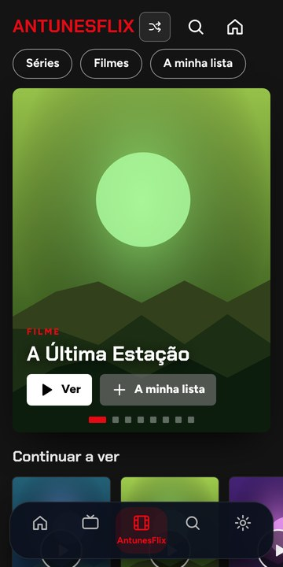
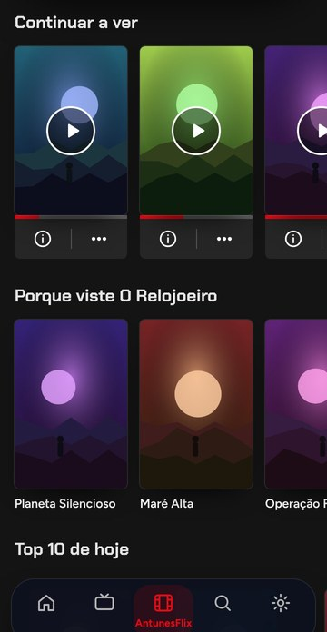
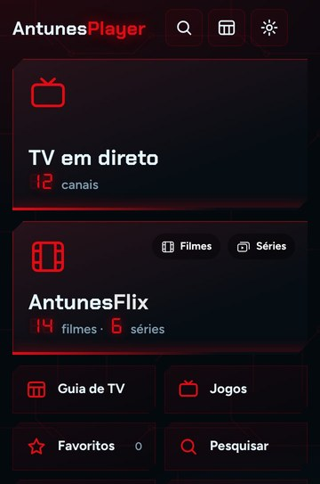
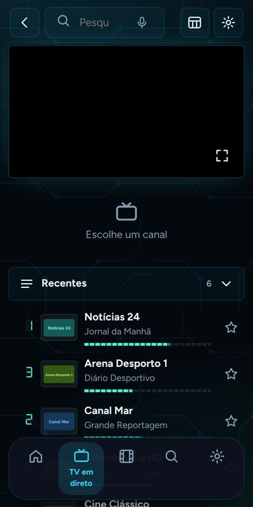
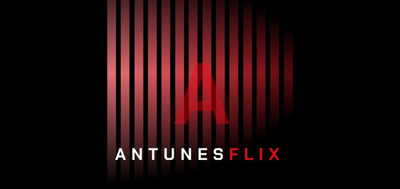
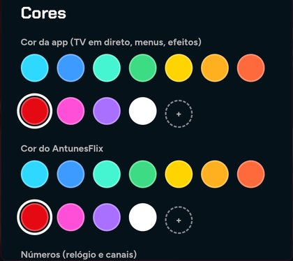

# AntunesPlayer

An **IPTV player** for Android phones, **Google TV** and the browser — with **AntunesFlix** inside: films and series organised like a streaming service. Bring your own Xtream login or M3U playlist; AntunesPlayer comes with **no channels**.

   

**Download:** [latest APK](https://github.com/JoaoAntunesss/AntunesPlayer/releases/latest) (Android / Google TV) · **Web:** [joaoantunesss.github.io/AntunesPlayer](https://joaoantunesss.github.io/AntunesPlayer/) · TVs can open [/tv](https://joaoantunesss.github.io/AntunesPlayer/tv/) to download it.

## What it does
- **AntunesFlix** — billboard, Top 10, a row per genre, My list, Continue watching across films and series, next-episode countdown, watched marks, resume “T1:E3”, Netflix-style title page, its own intro animation.
- **Live TV** — guide grid with catch-up and reminders, number zapping, favourites in your own order (import from other apps), own channel lists, see-through channel list on the remote's ◀, sleep timer, stream info and quality, open in VLC/MX Player.
- **Your account** — sign in with Google: playlists (logins encrypted on the device), favourites, progress and settings follow you; a TV signs in with a short code from the phone.
- **Subtitles** — found online (OpenSubtitles) in your languages and switched on by themselves.
- **Yours to shape** — app colour, AntunesFlix colour, digits and background; settings in tabs; Portuguese and English; parental PIN; in-app updates.

 

## Earlier versions

## v3 — player, catch-up, parental control, Google TV

- **Full-screen player like iMPlayer**: top bar (info, favourite, audio/subtitles, picture size, more), big centre controls, resolution badge, now/next bar.
- **Channel list without leaving the video**: press ◀ on the remote for a see-through panel on the left (◀ ▶ change group, ▲ ▼ move, OK plays); on phones swipe up or tap *More channels* for a strip of group chips and channel cards.
- **Gestures**: swipe up/down on the left for brightness, on the right for volume; double-tap the sides to skip ±10 s in films.
- **Movies & series home**: Top 10 carousel, rows for continue watching, favourites, recently added and each category, rating badges, sort A–Z / newest / rating.
- **Catch-up** (Xtream channels with archive): past programmes in the side guide and the TV guide play from the server's archive.
- **Parental control**: a PIN, hide categories, lock categories (adult categories are locked automatically when you set a PIN).
- **Series**: the next episode starts by itself.
- **Google TV / Android TV**: launcher banner, D-pad navigation everywhere, the back button closes panels before leaving.

## Layout (v2)

Built like the IPTV apps people already know (IPTV Smarters, TiviMate, iMPlayer):

- **Home**: big tiles for Live TV, Movies and Series, plus TV guide, favourites, search, playlists and the Xtream account (expiry date, connections). Continue watching and recent channels below.
- **Live TV**: categories · channel list · preview player with the programme guide. Tap a channel to preview, tap again for full screen.
- **Movies / Series**: categories and a poster grid. A detail page shows poster, year, genre, rating and plot; series have seasons and episodes.
- **Full screen player**: channel number and name, now/next bar, zapping with ↑/↓ or swipes, quick channel list, audio/subtitles, picture size, double-tap to skip ±10 s in films.
- Remote / D-pad navigation on Android TV, number keys jump to a channel. The Android app runs full screen and the back button works as expected.

## Use it
Open the page, press **Add playlist**, paste your link (or *Try demo channels* for free test streams).

## Good to know (honest limits)
Browsers are stricter than VLC or Kodi:
- The server must allow web pages to read it (**CORS**). If a playlist fails with a network error, use the *helper link* in Settings (a small CORS proxy you control: `https://your-helper.example/?url={url}`).
- If AntunesPlayer is served over `https`, streams must be `https` too (mixed content is blocked).
- Recording uses the browser's MediaRecorder and only works for streams the page is allowed to capture.
- AntunesPlayer only plays what you give it. Use playlists you are entitled to watch.

## Host it
Any static host works: GitHub Pages (branch `main`, root) or Firebase Hosting (`firebase deploy`).

## Code layout
The app is plain JavaScript with no framework. The source is split by feature in `src/` (formatted with Prettier):

| File | What it does |
|---|---|
| `src/00-core.js` | helpers, translations, storage, app state |
| `src/01-playlist.js` | M3U parser and XMLTV TV guide |
| `src/02-sources.js` | playlists, favourites import/export, TV detection |
| `src/03-player.js` | video player (hls.js, mpegts.js), browser recording |
| `src/04-dialogs.js` | dialogs and settings |
| `src/05-player-extras.js` | pause, seek, resume, audio/subtitle tracks, picture size |
| `src/06-icons.js` | SVG icon set |
| `src/07-navigation.js` | screens and full screen |
| `src/08-player-chrome.js` | on-screen controls, gestures, channel panel |
| `src/09-home.js` | header, home screen, lists |
| `src/10-browse.js` | live TV, films and series lists |
| `src/11-detail.js` | film and series pages |
| `src/12-favourites-guide.js` | favourites, TV guide, playlist manager, wiring |
| `src/13-remote.js` | voice search, TV remote and keyboard |
| `src/14-updates-extras.js` | app updates, sleep timer, reminders, stream info |
| `src/15-sports.js` | games agenda from the TV guide |
| `src/16-subtitles.js` | online subtitles (OpenSubtitles) |
| `src/17-antunesflix.js` | AntunesFlix home and genre rows |
| `src/18-cast-downloads.js` | Chromecast and offline downloads |
| `src/19-flix-extras.js` | trailers, On now, new episodes, statistics |
| `src/20-tutorial.js` | first-run tutorial |
| `src/21-imdb-catalogue.js` | IMDb ratings, daily rows, full catalogue |
| `src/22-skip-intro.js` | skip intro |
| `src/23-flix-detail.js` | AntunesFlix intro and title page |
| `src/24-colours.js` | colour themes |
| `src/25-cloud-sync.js` | Google sign-in and encrypted sync |
| `src/26-profiles.js` | profiles and kids profile |
| `src/27-multiscreen.js` | 2 or 4 channels at once |
| `src/28-recording.js` | scheduled recordings (Android) |
| `src/29-start.js` | start-up |
| `src/30-search.js` | search: accents, punctuation, word order, typos, Portuguese/English titles |
| `src/31-streaming.js` | "On Netflix", "On HBO Max"… rows (playlist categories + TMDB data) |

`node scripts/build-app.mjs` joins them, in order, into `js/app.js`, the file the web, Android and Windows versions load. They share one private scope, so there are no imports between files. CI checks that `js/app.js` is up to date and that `src/` is formatted. The native Android parts (background recording, downloads, Chromecast, the TV home-screen channel) are in `scripts/android_patch.py`, which adds them to the Capacitor project at build time.

## Run locally
    node scripts/build-app.mjs     # after editing src/
    python3 -m http.server 8790    # then open http://localhost:8790

## Credits
[hls.js](https://github.com/video-dev/hls.js) (Apache-2.0), [mpegts.js](https://github.com/xqq/mpegts.js) (Apache-2.0), Bricolage Grotesque and Figtree (SIL OFL).

## Android app (APK) and Android TV

The same code ships as an Android app, built automatically on GitHub (no PC tools needed).

1. Open the repo's **Releases** page and download `AntunesPlayer.apk` from the `latest` release (or run the *Build Android APK* workflow under **Actions**).
2. On the phone / TV box, open the file and allow "install from this source".
3. On Android TV it appears in the launcher; the remote's number keys switch channels.

In the app, streams load through the native HTTP layer, so servers that block browsers (CORS) and plain `http://` streams work. Status: built by CI, not yet tested on a real device.

## Web version

Enable **Settings → Pages → Deploy from branch → main / root** and open `https://<user>.github.io/AntunesPlayer/`.
